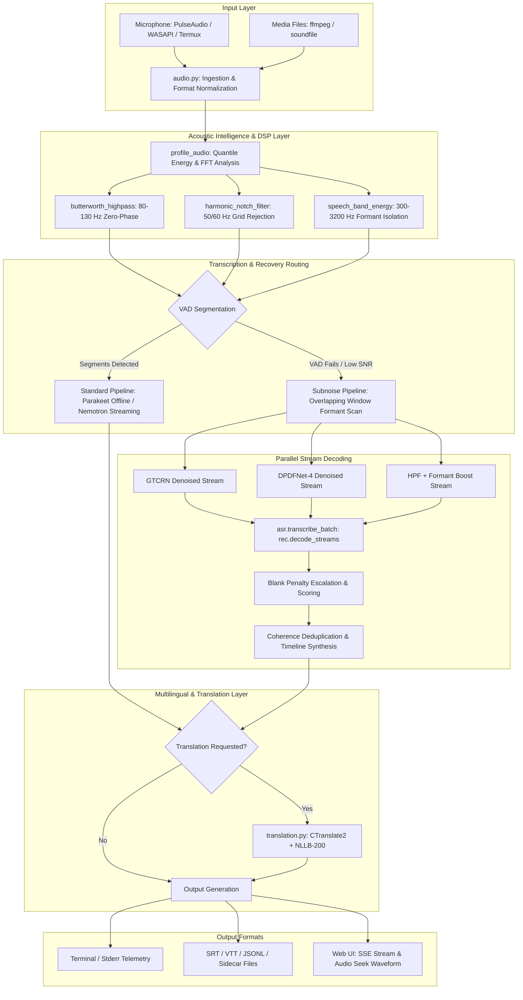

# Architecture & Technical Schematics: `talk-to-typed` (STT)

## 1. System Vision & Core Differentiators
`talk-to-typed` (`stt`) is an industrial-grade, CPU-optimized, fully offline speech-to-text and speech-enhancement system. Unlike traditional ASR wrappers that rely on cloud APIs or heavy GPU runtimes (e.g., vanilla Whisper requiring CUDA or VRAM), `talk-to-typed` is engineered from first principles for zero-dependency local execution across Linux, Android (Termux/Kali userland), and Windows.

### Key Differentiators:
1. **Sub-Noise-Floor Speech Recovery**: Standard ASR engines (Whisper, Vosk, Kaldi) rely on binary Voice Activity Detectors (Silero, WebRTC). When vocal energy drops near or below the acoustic noise floor, or when low-frequency rumble (>85% energy <100 Hz) saturates the dynamic range, traditional VADs classify the audio as dead silence and drop the file. `stt` implements an **Adaptive Acoustic Profiler** and a **Subfloor Sliding-Window Scanner** that bypasses VAD failure, strips rumble/hum, boosts speech formants, and recovers buried phonemes.
2. **Pure-NumPy Zero-Phase Frequency-Domain DSP**: No heavy DSP frameworks (`scipy`, `torchaudio`, `librosa`) are required. Zero-phase Butterworth high-pass filters, harmonic electrical hum notch filters, and speech-band energy integration are executed directly in NumPy using FFT/IRFFT.
3. **Multi-Model Neural Blending & Stream Parallelization**: Rather than hoping a single denoiser preserves faint formants, `stt` batches multiple candidate representations (`gtcrn`, `dpdfnet4`, high-pass filtered audio, blank-penalty escalated decodes) and decodes them concurrently via native ONNX multithreading (`rec.decode_streams()`).
4. **100% Offline & Private**: Zero telemetric egress, zero cloud endpoints, zero root permissions needed.

---

## 2. High-Level System Architecture & Component Diagram



---

## 3. Directory Layout & Module Responsibilities

```text
stt/
├── asr.py           # Model loading, recognizer caching, single & batched stream decodes
├── audio.py         # Ingestion, zero-phase DSP, AcousticProfile, Silero VAD, DPDFNet/GTCRN
├── cli.py           # Command-line interface, interactive wizard, timeline formatting, dispatch
├── config.py        # Platform-aware config resolution (XDG vs AppData), TOML serialization
├── mic.py           # Multi-platform audio capture backends (Pulse, WASAPI, Termux:API)
├── robust.py        # Aggressiveness levels 0-5, subnoise scanning, deduplication, auto-tuning
├── translation.py   # CTranslate2 engine with NLLB-200 distilled 600M and language detection
└── ui.py            # Zero-dependency HTTP/SSE web interface with waveform seeking
```

### Module Responsibilities:

#### `stt/audio.py`
- **Audio Ingestion**: Spawns non-blocking `ffmpeg` subprocesses converting any multimedia container into 16 kHz mono 32-bit floating-point arrays normalized to $[-1.0, 1.0]$.
- **Zero-Phase Butterworth Filter** (`butterworth_highpass`):
  Frequency-domain filter function:
  $$H(f) = \frac{1}{\sqrt{1 + (f_c / f)^{2N}}}$$
  Filters rumble with zero phase delay ($H(0) = 0$).
- **Harmonic Hum Rejection** (`harmonic_notch_filter`):
  Multi-harmonic notch filter centered on $f_0, 2f_0, 3f_0$ (either 50 Hz or 60 Hz fundamental) with a tunable -3 dB bandwidth:
  $$H_{\text{notch}}(f) = \prod_{k=1}^{3} \frac{(f - k f_0)^2}{(f - k f_0)^2 + (\Delta f / 2)^2}$$
- **Speech Formant Band Isolation** (`speech_band_energy`):
  Isolates spectral energy in the 300 Hz to 3200 Hz human vowel and consonant range via inverse FFT of the band-limited spectrum:
  $$\text{RMS}_{\text{speech}} = \sqrt{\frac{1}{N} \sum_{n=0}^{N-1} x_{\text{filtered}}[n]^2}$$
- **Acoustic Profiler** (`profile_audio`):
  Computes short-time 50ms frame energy quantiles ($P_{15}$ for baseline noise floor, $P_{95}$ for peak energy), calculates empirical SNR, analyzes hum peak prominence, assesses rumble fraction, and dynamically outputs an `AcousticProfile`.

#### `stt/asr.py`
- **Recognizer Management**: Caches `sherpa_onnx.OfflineRecognizer` instances configured with `tokens.txt`, `encoder.onnx`, `decoder.onnx`, and `joiner.onnx`.
- **Batched Stream Decoding** (`transcribe_batch`):
  Creates multiple concurrent `sherpa_onnx.OfflineStream` handles and invokes `rec.decode_streams(streams)` in a single native multithreaded step. This parallelizes decoding across multiple denoiser candidates without Python thread contention.

#### `stt/robust.py`
- **Aggressiveness Progression (Levels 0 to 5)**:
  - Level 0: Pure VAD, zero denoising.
  - Level 1: Permissive VAD threshold (0.3).
  - Level 2: DPDFNet neural denoising with 50% clean signal blending.
  - Level 3: DPDFNet denoising, 30% blend, permissive VAD (0.1), 5.0s segments.
  - Level 4: Dual-variant execution (clean vs denoised), longest coherent transcript retained.
  - Level 5: High-gain normalization + DPDFNet-8 vs DPDFNet-4 tournament.
- **Auto-Escalation & Subfloor Recovery** (`subnoise_transcribe`):
  When standard VAD levels 0–5 return 0 segments, the system automatically triggers subfloor recovery:
  1. Profiles audio using `profile_audio`.
  2. Applies dynamic Butterworth high-pass cutoff (80 Hz to 130 Hz).
  3. Applies harmonic notch filtering if power-grid hum exceeds 4.0x prominence.
  4. Slides overlapping windows (5.0s–6.0s window, 1.25s–2.5s step) across the audio.
  5. Computes candidate streams (`gtcrn`, `dpdfnet4`, `hpf`) and executes `asr.transcribe_batch`.
  6. Escalates transducer blank penalty for windows with vocal energy returning empty text.
  7. Deduplicates overlapping detections using punctuation-agnostic word n-gram merging and coherence scoring.

#### `stt/translation.py`
- **CTranslate2 + NLLB-200**:
  Loads Meta's NLLB-200 distilled 600M model in int8 format with SentencePiece tokenization.
- **Language Detection** (`detect_language_simple` / `asr.detect_language_from_audio`):
  Combines acoustic audio probing with lexical function-word frequency analysis.
- **Segment Translation** (`translate_segments`):
  Translates `(start, end, source_text)` tuples into `(start, end, source_text, translated_text)`.

#### `stt/cli.py`
- Command-line interface exposing `file`, `mic`, `doctor`, `config`, and `ui`.
- Timeline formatting (`format_timestamp`): Generates `[MM:SS.mmm -> MM:SS.mmm]` intervals.
- Handles `--srt`, `--vtt`, `--jsonl`, and sidecar file exports.

---

## 4. Multi-Platform Hardware & OS Dispatch

| Capability | Linux (Debian / Kali) | Android (Termux / Proot) | Windows (10 / 11) |
| :--- | :--- | :--- | :--- |
| **Config Path** | `~/.config/stt/config.toml` | `~/.config/stt/config.toml` | `%APPDATA%\stt\config.toml` |
| **Model Storage** | `~/.local/share/stt/models` | `~/.local/share/stt/models` | `%LOCALAPPDATA%\stt\models` |
| **Audio Ingestion** | `ffmpeg` / `soundfile` | `ffmpeg` / `soundfile` | `ffmpeg` / `soundfile` |
| **Microphone** | PulseAudio (`parec`) | Termux:API (`termux-microphone-record`) / Pulse | DirectShow (`ffmpeg -f dshow`) / PortAudio (`sounddevice`) |
| **Process Model** | Bounded pipe reader thread | Async chunk worker | Named pipe / bounded worker thread |

---

## 5. Model Weights & Computational Footprint

| Role | Model Architecture | Int8 Size | RTF (4-core CPU) | Primary Use |
| :--- | :--- | :--- | :--- | :--- |
| **Offline ASR** | NeMo Parakeet TDT 0.6B v3 | 671 MB | 0.19–0.25x | `stt file`, `--whisper`, `--distant`, `--subnoise` |
| **Streaming ASR** | NeMo Nemotron 0.6B (160ms) | 640 MB | 0.22x (2 threads) | `stt mic` (real-time streaming) |
| **Ultra-fast Streaming** | Banafo Kroko Zipformer | 71 MB | 0.01x | `stt mic --model kroko` (low-resource streaming) |
| **VAD** | Silero VAD v4 | 1.8 MB | <0.005x | Voice activity endpointing and boundary gating |
| **Denoiser A** | DPDFNet-8 / DPDFNet-4 | 18 MB / 9 MB | 0.03x | Complex non-stationary noise suppression |
| **Denoiser B** | GTCRN Simple | 5 MB | 0.02x | High-transient spectral speech restoration |
| **Translation** | NLLB-200 Distilled 600M | 2.4 GB (CT2 int8) | ~0.5s / sentence | Multilingual offline cross-translation |

---

## 6. Subfloor Speech Recovery Mathematics

### Quantile Noise Floor Tracking
For audio signal $x[n]$, short-time RMS is evaluated across 50ms frames ($M = 800$ samples at 16 kHz):
$$\text{RMS}_k = \sqrt{\frac{1}{M} \sum_{m=0}^{M-1} x[kM + m]^2}$$
- **Noise Floor**: $\sigma_{\text{noise}} = \text{Percentile}(\{\text{RMS}_k\}, 15)$
- **Peak Signal**: $\sigma_{\text{peak}} = \text{Percentile}(\{\text{RMS}_k\}, 95)$
- **Empirical SNR**:
  $$\text{SNR}_{\text{dB}} = 20 \log_{10}\left(\frac{\max(\sigma_{\text{peak}}, 10^{-6})}{\max(\sigma_{\text{noise}}, 10^{-6})}\right)$$

### Dynamic Transducer Blank Penalty
Neural transducer joiners compute activations over the vocabulary:
$$P(y | x) = \text{Softmax}(z_{\text{token}})$$
Under low-SNR conditions, the model favors the blank token $\phi$. The blank penalty dynamically subtracts a bias $\beta$ from the blank logit:
$$\beta = \text{clip}\left(0.55 + (8.0 - \text{SNR}_{\text{dB}}) \times 0.03, \; 0.30, \; 1.05\right)$$
For silent windows returning empty transcripts despite speech-band energy, $\beta$ escalates to $\beta + 0.20$ and $\beta + 0.40$ to force token emission.

### Coherence Scoring
To reject stochastic noise hallucinations, candidates are scored using linguistic bigram repetition and dictionary heuristics:
$$\text{Score}(T) = \text{len}(T) \times \left(1.0 - 2.5 \times \frac{\text{duplicate bigrams}}{\text{total bigrams}}\right) \times \left(\frac{\text{valid dictionary tokens}}{\text{total tokens}}\right)$$
Only candidate transcripts exceeding threshold $\tau = 4.0$ are accepted into the timeline.
