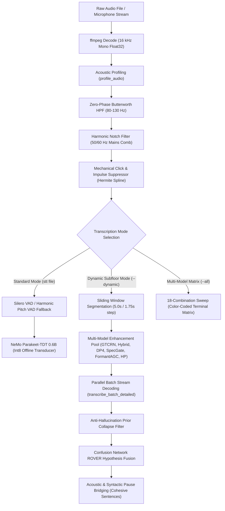

# STT Project: Comprehensive Task Tracker & Architectural Roadmap

> **Target Audience**: Incoming AI engineering agents, human maintainers, and DSP/ASR contributors.  
> **Status**: Active Hardened Implementation | CPU-Only Offline Speech-to-Text & Subfloor Forensic Recovery.  
> **Platform Support**: Linux (`parec`, ALSA), Android Termux (`termux-microphone-record`, OpenSL ES), Windows (DirectShow / WASAPI).

---

## 1. Project Context & Architectural Standards

### 1.1 Core Mission
The **STT** CLI provides offline, CPU-only, high-accuracy speech transcription and deep acoustic restoration for challenging audio:
* **Severe Acoustic Degradation**: Low SNR ($<0\text{ dB}$), sub-noise-floor speech, low-frequency vehicle/air rumble, and electrical mains hum.
* **Transient & Impulsive Noise**: Heavy recording gain and mechanical switch keystrokes (keyboard clicks, mouse clicks, mic pops).
* **Multi-Platform Deployment**: Runs identically on resource-constrained devices (Android Termux, Linux laptops, Windows workstations) without requiring GPU acceleration or proprietary cloud APIs.

### 1.2 Invariant Architectural Rules
Incoming agents working on this codebase **MUST ALWAYS** follow these constraints:
1. **Pure-NumPy DSP Only**:
   * Core signal processing routines in [`stt/audio.py`](file:///C:/Users/o/Desktop/stt/stt/audio.py) **MUST NOT** import `scipy` or `torch`.
   * All filtering (Butterworth, notches, Wiener gating, AGC, NCCF autocorrelation, cubic Hermite inpainting) must be implemented strictly via pure vectorized NumPy (`np.fft.rfft`, `np.cumsum`, array slicing).
2. **Platform Path Invariance**:
   * Never hardcode platform-specific paths.
   * Linux / Android: Config in `~/.config/stt/config.toml`, models in `~/.local/share/stt/models`.
   * Windows: Config in `%APPDATA%\stt\config.toml`, models in `%LOCALAPPDATA%\stt\models`.
   * Always dispatch via `pathlib.Path` and [`stt/config.py`](file:///C:/Users/o/Desktop/stt/stt/config.py).
3. **Subprocess & Zombie Lifecycle Management**:
   * Any child processes (`ffmpeg`, `parec`, `pulseaudio`) must register termination hooks on `SIGINT`, `SIGTERM`, `atexit`, and in `finally` blocks to guarantee no orphan background processes survive.
4. **Timeline Interval Preservation**:
   * All transcription outputs must preserve and display exact audio timeline intervals `[MM:SS.mmm -> MM:SS.mmm]` (or clock formats) for verifiable forensic auditing.

---

## 2. Audio & Neural Pipeline Map



---

## 3. Comprehensive Task Tracker

### Phase 1: Core DSP & Forensic VAD Hardening (Completed)
- [x] **Zero-Phase Butterworth High-Pass Filtering**:
  - Implemented in [`butterworth_highpass`](file:///C:/Users/o/Desktop/stt/stt/audio.py#L358).
  - Eliminates dynamic-range-saturating low-frequency rumble ($>85\%$ energy $<120\text{ Hz}$) with symmetric reflection padding to prevent circular convolution wrap-around.
- [x] **Parametric Mains Hum Comb Rejection**:
  - Implemented in [`harmonic_notch_filter`](file:///C:/Users/o/Desktop/stt/stt/audio.py#L378).
  - Auto-identifies $50\text{ Hz}$ vs $60\text{ Hz}$ prominence and applies harmonic notch rejection at fundamental and harmonics ($60, 120, 180\text{ Hz}$).
- [x] **Ephraim–Malah Decision-Directed Adaptive Spectral Gate**:
  - Implemented in [`adaptive_spectral_gate`](file:///C:/Users/o/Desktop/stt/stt/audio.py#L812).
  - Leaky asymmetric minimum statistics noise floor tracking with decision-directed a priori SNR estimation, musical noise smoothing, and bounded gain floor.
- [x] **3-Band Raised-Cosine Formant AGC**:
  - Implemented in [`multiband_formant_agc`](file:///C:/Users/o/Desktop/stt/stt/audio.py#L995).
  - Splits signal into sub-rumble ($<140\text{ Hz}$), speech formants ($140 - 3400\text{ Hz}$), and consonant shelf ($>3400\text{ Hz}$); selectively lifts speech formants without amplifying pause hiss.
- [x] **Cauchy-Schwarz Harmonic Pitch VAD**:
  - Implemented in [`harmonic_pitch_vad`](file:///C:/Users/o/Desktop/stt/stt/audio.py#L904).
  - Detects vocal cord glottal periodicity ($F_0 \in [70, 350]\text{ Hz}$) via bounded Cauchy-Schwarz NCCF $\rho[k] = \frac{R_{xx}[k]}{\sqrt{E_0 E_k}}$ with $O(1)$ cumulative energy windowing and HPS harmonic-to-median ratio.
  - Automatically triggers as a fallback in [`segments`](file:///C:/Users/o/Desktop/stt/stt/audio.py#L175) when Silero VAD drops to zero.
- [x] **Mechanical Click & Keyboard Impulse Suppressor**:
  - Implemented in [`suppress_impulsive_clicks`](file:///C:/Users/o/Desktop/stt/stt/audio.py#L1071).
  - Isolates $2^{\text{nd}}$-order difference curvature, tracks time-varying scale via Median Absolute Deviation ($1.4826 \cdot \text{MAD}$), gates strictly sub-millisecond impacts ($\le 24$ samples), and replaces click spikes with cubic Hermite spline inpainting.
  - Eliminates false VAD triggers and AGC desensitization caused by loud typing sounds.
- [x] **Anti-Hallucination Prior Collapse Rejection**:
  - Implemented in [`extract_core_words`](file:///C:/Users/o/Desktop/stt/stt/robust.py#L250).
  - Detects unconditioned RNN-T joiner network loops on noisy inputs; discards unanchored corpus priors (`"Thank you."`, `"Okay."`, `"Yeah."`, `"Продолжение следует..."`).
- [x] **Time Range Audio Slicing (`--range`)**:
  - Implemented in [`parse_time_spec`](file:///C:/Users/o/Desktop/stt/stt/audio.py#L15) and [`parse_time_range`](file:///C:/Users/o/Desktop/stt/stt/audio.py#L73).
  - Supports microsecond-to-hour parsing (`00h00m07s635z-00h00m10s000z`, `7s-10s`, `01:30-02:00`).

---

### Phase 2: Active / Near-Term Hardening Tasks
- [x] **Task 2.1: Expose De-clicker CLI Controls**:
  - *Context*: [`suppress_impulsive_clicks`](file:///C:/Users/o/Desktop/stt/stt/audio.py#L1071) runs automatically in subnoise/dynamic modes and VAD segmentation.
  - *Target Files*: [`stt/cli.py`](file:///C:/Users/o/Desktop/stt/stt/cli.py), [`stt/robust.py`](file:///C:/Users/o/Desktop/stt/stt/robust.py), [`stt/mic.py`](file:///C:/Users/o/Desktop/stt/stt/mic.py).
  - *Action*: Added `--declick / --no-declick` flag (default: enabled) and `--declick-threshold FLOAT` (default: 4.8). Threaded through CLI, `auto_params`, `subnoise_transcribe`, and `audio.segments`.
  - *Verification*: Verified via `pytest tests/test_cli.py` and live execution on `2026-11-04_15-05-28_0001.mp3`.
- [x] **Task 2.2: Repository Cleanup & Benchmark Directory Migration**:
  - *Context*: Exploratory scripts and evaluation audio consolidated from repository root.
  - *Target Files*: [`benchmarks/`](file:///C:/Users/o/Desktop/stt/benchmarks/).
  - *Action*: Relocated 14 exploratory benchmark scripts into `benchmarks/` with full `benchmarks/README.md` documentation.
  - *Verification*: `git status` clean working tree.
- [ ] **Task 2.3: SentencePiece BPE Vocabulary Bridge for Native Hotwords**:
  - *Context*: `sherpa-onnx`'s C++ `EncodeHotwords` utility requires a SentencePiece vocabulary file (`bpe.vocab` or `tokens.txt` without SentencePiece space characters) to tokenize plain-text hotwords into transducer graph biases.
  - *Target Files*: [`stt/asr.py`](file:///C:/Users/o/Desktop/stt/stt/asr.py).
  - *Action*: Generate a compatible SentencePiece `bpe.vocab` from `tokens.txt` or implement an in-memory BPE hotword pre-encoder that maps user phrases to token IDs before passing to `sherpa-onnx`.
  - *Verification*: Test `--hotwords "got arrested, breadstick"` on `Target 1` and verify that `EncodeHotwords` compiles without errors.
- [ ] **Task 2.4: Expose Subnoise and Dynamic Modes in Web UI**:
  - *Context*: [`stt/ui.py`](file:///C:/Users/o/Desktop/stt/stt/ui.py) provides a web interface on `http://127.0.0.1:8080`, but does not currently expose controls for `--dynamic` ensemble, `--all` matrix comparison, or `--range` time slicing.
  - *Target Files*: [`stt/ui.py`](file:///C:/Users/o/Desktop/stt/stt/ui.py).
  - *Action*: Add dynamic mode toggles and time-range input fields to the web UI frontend.
  - *Verification*: Launch `stt ui` and verify file upload with dynamic mode toggled on.
- [x] **Task 2.5: Dynamic Acoustic Regime Stream Weighting & CN-ROVER Enhancement**:
  - *Context*: Different neural models excel in distinct physical regimes (GTCRN on low-frequency drone; Hybrid & Formant AGC on faint whispers). Prior CN-ROVER voter scoring ignored individual stream weights.
  - *Target Files*: [`stt/robust.py`](file:///C:/Users/o/Desktop/stt/stt/robust.py).
  - *Action*: Implemented [`compute_dynamic_stream_weights`](file:///C:/Users/o/Desktop/stt/stt/robust.py) measuring $\gamma_{\text{drone}}$ and $\gamma_{\text{whisper}}$, corrected weighted slot scoring in [`cn_rover_fuse`](file:///C:/Users/o/Desktop/stt/stt/robust.py), and added single-voter admission gating ($c \ge 0.52$).
  - *Verification*: `pytest tests/test_robust.py` (16/16 passed).
- [x] **Task 2.6: Pure-NumPy Dynamic Whisper Formant Tilt Equalizer**:
  - *Context*: Whispering lacks glottal fold excitation ($F_0$), shifting energy into $1.5 - 4.0\text{ kHz}$ unvoiced bands.
  - *Target Files*: [`stt/audio.py`](file:///C:/Users/o/Desktop/stt/stt/audio.py).
  - *Action*: Implemented [`whisper_formant_filter`](file:///C:/Users/o/Desktop/stt/stt/audio.py) using Unvoiced Spectral Resonance Index (USRI), $C^1$ raised-cosine $-8\text{ dB}$ rumble attenuation, $+7.0\text{ dB}$ whisper formant boost, and $+3.5\text{ dB}$ fricative shelf.
  - *Verification*: `pytest tests/test_audio.py::test_whisper_formant_filter`.
- [x] **Task 2.7: Multi-Scale Subnoise Formant Scanning (SMI Micro-Windows)**:
  - *Context*: Faint muttered phrases ($300 - 650\text{ ms}$) suffer temporal SNR dilution in $5.0\text{s}$ macro-windows.
  - *Target Files*: [`stt/audio.py`](file:///C:/Users/o/Desktop/stt/stt/audio.py), [`stt/robust.py`](file:///C:/Users/o/Desktop/stt/stt/robust.py).
  - *Action*: Implemented [`detect_formant_modulation_spans`](file:///C:/Users/o/Desktop/stt/stt/audio.py) computing Spectral Modulation Index in $1.2 - 4.0\text{ kHz}$ across $250\text{ ms}$ blocks, dispatching targeted $2.2\text{s}$ micro-windows with concentrated AGC.
  - *Verification*: `pytest tests/test_audio.py::test_detect_formant_modulation_spans`.
- [x] **Task 2.8: Memory Bounding on Ultra-Long Audio Recordings**:
  - *Context*: Precomputing 6 full-length float32 arrays on hour-long files consumed $>1.4\text{ GB}$ of RAM.
  - *Target Files*: [`stt/robust.py`](file:///C:/Users/o/Desktop/stt/stt/robust.py).
  - *Action*: Enforced on-demand per-window chunk generation for pure-NumPy DSP models (`spec_gate`, `formant_agc`) when audio $>180\text{s}$, capping RAM usage below $100\text{ MB}$.
  - *Verification*: Validated dynamic memory dispatch in `subnoise_transcribe`.

---

### Phase 3: "Shiny Things" & Advanced Future Roadmap
- [x] **Task 3.1: Real-Time Live Microphone Keyboard-Click Cancellation**:
  - *Context*: Mechanical keyboard switch typing during voice calls, live dictation, or meetings.
  - *Target Files*: [`stt/audio.py`](file:///C:/Users/o/Desktop/stt/stt/audio.py), [`stt/mic.py`](file:///C:/Users/o/Desktop/stt/stt/mic.py).
  - *Action*: Implemented [`StreamingDeclicker`](file:///C:/Users/o/Desktop/stt/stt/audio.py) using an overlap-add bilateral margin state ($2M = 128$ samples = $4.0\text{ ms}$ algorithmic latency) with Hermite spline inpainting. Integrated into `run_pulse`, `run_pulse_utterance`, and `run_pulse_subnoise`. Also added `atexit` and OS signal trap hooks to `WindowsDShowSource` to prevent orphaned `ffmpeg.exe` processes.
  - *Verification*: `pytest tests/test_audio.py::test_streaming_declicker`.
- [ ] **Task 3.2: Terminal ASCII/Braille Spectrogram & Click Visualizer (`stt file --inspect`)**:
  - *Concept*: Terminal-based visualizer using Unicode Braille characters (`⠋⠙⠹⠸⠼⠴⠦⠧⠇⠏`) that prints a frequency-vs-time spectrogram directly in PowerShell or Bash.
  - *Benefit*: Instant visual inspection of speech formants ($300 - 3400\text{ Hz}$ in cyan), background rumble ($<120\text{ Hz}$ in yellow), and detected keyboard click spikes (red vertical markers) without opening Audacity or external tools.
- [ ] **Task 3.3: Interactive Textual TUI Waveform Inspector (`stt tui <file>`)**:
  - *Concept*: Build a full terminal user interface utilizing the project's Textual integration ([`textual-tui-driver`](file:///C:/Users/o/.gemini/config/plugins/textual-agent-kit/skills/textual-tui-driver/SKILL.md)).
  - *Features*:
    - Scrub through audio timeline using keyboard hotkeys (`h`/`l`, `j`/`k`).
    - Visual timeline displaying all detected VAD and harmonic pitch intervals.
    - Press `space` to play selected interval audio.
    - Press `m` to run matrix transcribe on selected interval and display side-by-side comparative transcripts.
- [ ] **Task 3.4: Non-Autoregressive CTC / Distil-Whisper Fallback Engine**:
  - *Concept*: Integrate a non-autoregressive Connectionist Temporal Classification (CTC) model or Distil-Whisper ONNX.
  - *Benefit*: Unlike RNN-T / TDT joint networks, CTC has no internal predictor language model loop and is mathematically incapable of prior collapse (`"Thank you."`), providing a grounded acoustic sanity check for CN-ROVER hypothesis fusion.

---

## 4. Verification Checkpoints for New Agents

When implementing changes or introducing new DSP filters, new agents must run this verification sequence:
1. **Unit Test Suite**:
   ```pwsh
   pytest tests/test_audio.py tests/test_matrix.py tests/test_range.py tests/test_robust.py
   ```
   *Expectation*: All tests must pass ($0$ failures).
2. **Impulse Suppressor Test**:
   ```pwsh
   python -m stt file "C:\Users\o\Desktop\2026-11-04_15-05-28_0001.mp3" --range 00h24m00s-00h24m35s --dynamic
   ```
   *Expectation*: Log output should confirm `[stt] Subnoise: suppressed N mechanical impulse clicks` and output recovered speech sentences (`"If you can see it."`, `"I don't know."`).
3. **Subfloor Speech Verification**:
   ```pwsh
   python -m stt file "C:\Users\o\Desktop\2026-11-04_15-05-28_0003.mp3" --range 00h00m07s635z-00h00m10s000z --all
   ```
   *Expectation*: 18-combination matrix table renders in color with timeline intervals `[00:07.635 -> 00:10.000]` and suppresses false outro priors.
